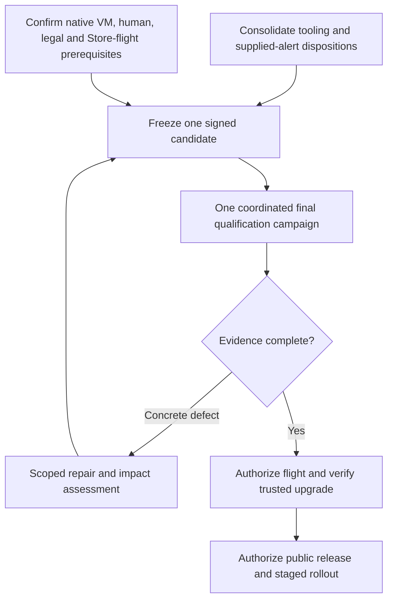

# JPG Spinner 2.0 release completion replan

Status: execution order accepted by the owner's instruction to proceed, 2026-10-25. This addendum organizes the
[approved modernization plan](2026-08-30-jpg-spinner-modernization.md); its
product requirements and approved amendments remain authoritative. It grants
no Store submission, signing, installation, remote dispatch or alert dismissal.
The accepted R2 execution remains active. No new implementation is required
merely to satisfy workflow bookkeeping.

## Outcome and distinct finish lines

The objective is one qualified JPG Spinner 2.0.0 candidate, followed by an
explicit decision to distribute it. Three outcomes need separate evidence:

1. **Implementation checkpoint:** maintained source, focused regression proof,
   signed commits and an honest inventory of remaining work.
2. **Qualified release candidate:** one frozen source identity, exact packages
   and required technical, device, accessibility, upgrade and legal evidence.
3. **Published release:** deliberate authorization, Microsoft certification and
   the approved staged rollout with observed results.

Successful source publication or CI advances the first outcome. It does not
complete the other two. The protected Store preparation workflow still needs
its actual hosted qualification; there is no authorized automatic submission.

## Baseline when drafted

| Workstream                                   | Observed result                                                                                                                                                                                                                                           | Remaining boundary                                                                                                                                                                                                                                  |
| -------------------------------------------- | --------------------------------------------------------------------------------------------------------------------------------------------------------------------------------------------------------------------------------------------------------- | --------------------------------------------------------------------------------------------------------------------------------------------------------------------------------------------------------------------------------------------------- |
| Product implementation and legacy retirement | Maintained replacement exists; signed `e1eb2361` retires the old application source.                                                                                                                                                                      | Final qualification is governed by Task 20.                                                                                                                                                                                                         |
| Ordinary hosted QA                           | [Run 40176250565](https://github.com/Hadden-Industries/jpg-spinner/actions/runs/40176250565), source `0d78e54b`: all ten jobs pass, including native packages, ASan and analysis; 1,513 headless testcase executions have no JUnit failures/errors/skips. | ARM64 is compile/package evidence; no physical runtime or release approval. See the [exact evidence boundary](../implementation/2026-10-25-hosted-qa-completion.md).                                                                                |
| Known dependency alerts                      | GitHub reports all four `fast-uri` Dependabot alerts fixed after publication.                                                                                                                                                                             | This does not classify other findings or qualify all release tooling.                                                                                                                                                                               |
| Native CodeQL                                | [Run 40179840428](https://github.com/Hadden-Industries/jpg-spinner/actions/runs/40179840428), source `435b87b3`, CodeQL 2.27.3: execution succeeds; analysis `2021870605` reports 29 results. Five historical alerts also remain open.                    | Triage the supplied results and record justified dispositions. The 29 paths comprise four generated SDK headers, ten test-harness locations and fifteen dependency/build-probe locations; those are routing categories, not vulnerability verdicts. |
| Version refresh                              | Official metadata identifies Syft SDK 1.55.0 and CodeQL Action 4.39.1. Native Go selects/verifies 1.55.0; the unchanged adapter's ten unit tests pass in a private candidate.                                                                             | Neither update is adopted yet. The SDK still needs the independent official-schema/semantic and actual component-coverage checks. No new CodeQL run is authorized.                                                                                  |
| Freshness regression                         | Four uncommitted PowerShell files extend coverage to action/SBOM pins and native pagination. Focused RED/GREEN controls pass.                                                                                                                             | Consolidate, format/lint and commit this bounded change; do not intermingle unrelated repairs.                                                                                                                                                      |
| Source publication                           | Remote `main` is `435b87b3`; local signed documentation checkpoint is `76191e8d`.                                                                                                                                                                         | A future push needs its actual scoped authority. No automatic CI trigger is introduced.                                                                                                                                                             |
| Resources                                    | Required ordinary-QA and CodeQL originals are independently retained. Ordinary-QA cloud artifact count is zero.                                                                                                                                           | Existing local cleanup holds remain under [HISEW #197](https://github.com/Hadden-Industries/software-engineering-workflow/issues/197#issuecomment-6395313372). Preserve blocked directories; do not work around native admission.                   |

The current package log's unused `NEON_INTRINSICS` CMake option warning also
has a subsequent [source-backed classification](../implementation/2026-10-25-qualified-tooling-refresh.md#evidence-and-next-work):
it is an obsolete upstream-port configure input, outside the compiler-warning
condition. Preserve the successful run and original warning; add no overlay,
authority change or suppression.

## Why the approach became reactive

Subsequent execution closes the [freshness repair](../implementation/2026-10-25-release-tool-freshness.md)
and [qualified tooling adoption](../implementation/2026-10-25-qualified-tooling-refresh.md)
in signed checkpoints `f722cc9858e2` and `057fc66cda92`. The
[supplied-result dispositions](../implementation/2026-10-25-codeql-result-dispositions.md)
cover all 34 inputs without another scan or automatic GitHub mutation. The
[prerequisite register](../release-prerequisites.md) records actual resource
availability. The subsequently approved single-maintainer amendment resolves
the original protected-environment absence. The baseline
above remains historical; do not use it as a competing current work queue.

The work lacked a single candidate boundary and a visible critical path.
New tooling releases, fixture defects, old alert configurations and HISEW
cleanup failures repeatedly entered the same queue as product qualification.
We also delayed establishing whether device, human and credentialed release
requirements could be completed. More builds cannot establish those facts.

The correction is a small number of bounded workstreams, with explicit exit
conditions and a single integration owner. The executing engineer owns source
integration and evidence consolidation; the maintainer owns consequential
product/resource decisions and release authorization. No implementation
delegation, external review or additional security scan is introduced.

## Ordered work and exit conditions

The original plan uses numbered tasks rather than a REQ/AC/QA/DEC identifier
scheme. This traceability table references those existing acceptance clauses
and actual owner decisions; it asserts no invented pre-existing identifiers.
The slice labels below identify sequencing only.

| Slice                                                   | Existing acceptance / decision                                                                              | Work and falsifiable exit condition                                                                                                                                                                                                                                                                                                                                                                                                                              | Owner / release and cleanup implication                                                                                                                                                                                                                                                                                      |
| ------------------------------------------------------- | ----------------------------------------------------------------------------------------------------------- | ---------------------------------------------------------------------------------------------------------------------------------------------------------------------------------------------------------------------------------------------------------------------------------------------------------------------------------------------------------------------------------------------------------------------------------------------------------------- | ---------------------------------------------------------------------------------------------------------------------------------------------------------------------------------------------------------------------------------------------------------------------------------------------------------------------------- |
| SLICE-001: Consolidated engineering checkpoint          | Tasks 17–18 and 20.1; current-version, TDD, DRY and no-shim instructions                                    | Finish the already-started native tooling qualification. The freshness gate must detect newer action/SDK releases, reject malformed or duplicate live JSON and refuse incomplete pagination. Adopt only native, integrity-verified updates that preserve the independent SBOM fixture and actual component identities. Keep valid fixtures tied to canonical pins; keep refusal oracles independent. Format/lint exact commit scopes and commit logical changes. | Engineer. Preserve failed attempts and exact original locks. The private Go candidate/cache remains needed only for this defined qualification, then enters native evidence-preserving cleanup.                                                                                                                              |
| SLICE-002: Disposition of the supplied alerts           | Task 17 security-extended requirement, Task 19 historical reconciliation, explicit one-run CodeQL exception | Produce one source-backed verdict per current result and retain the five historical alerts separately. Trace reachability and controls for generated/dependency code and the actual test harness. Fix confirmed defects with focused RED/GREEN proof. Keep unresolved findings explicit. No blanket exclusions, speculative library patches, alert dismissal or historical-analysis deletion.                                                                    | Engineer for evidence/fixes; maintainer for consequential GitHub administrative dispositions. This is targeted supplied-finding work, not another broad scan.                                                                                                                                                                |
| SLICE-003: Release prerequisites ready                  | Tasks 16, 18 and 20.3–20.7; approved Store-managed signing and trusted-upgrade sequencing                   | Establish available native Windows ARM64 VM and required OS/provider lanes; an operator for assistive-technology/localization acceptance; qualified legal/source-delivery review; historical credential-owner action; and an authorized Partner Center flight/upgrade route. Record actual owner, available environment and evidence to be produced for each. A prerequisite without an available owner/lane remains blocked.                                    | Maintainer and the named device, accessibility, legal and credentialed release owners. Establish availability alongside the bounded engineering slices, before another expensive complete release campaign.                                                                                                                  |
| SLICE-004: Freeze one candidate                         | Task 20.1–20.2 and the instruction to consolidate before final verification                                 | Close the engineering batch, perform one authoritative stable-version audit and select a signed, clean source commit. Record pins, exact intended architectures, evidence matrix and remaining authorizations in one candidate manifest/register. No feature, parser, compatibility or build-system redesign enters after this boundary without an explicit defect and impact assessment.                                                                        | Engineer. The final campaign starts only when its prerequisite environments and owners are available. Source publication is separately authorized for the exact commit/destination.                                                                                                                                          |
| SLICE-005: One coordinated final qualification campaign | Task 20.2–20.6; approved closed package comparison; 24-hour fuzz waiver; current review restrictions        | Execute the accepted independent-build, headless/sanitizer/analysis, bounded fuzz, corpus/recovery, packaged/device, performance, accessibility and localization evidence matrix against that candidate. Bind the exact selected bundle to native validation, approved comparison, SBOM and authenticated provenance; prepare corresponding source and certification evidence. Every row has a source/artifact identity, operator, command/report and result.    | Engineer coordinates; specialist/device owners supply their own evidence. Reuse valid scoped results according to actual inputs. Full qualification runs once for the final consolidated candidate; a concrete failure receives one narrow repair cycle before reassessment. A new security run requires explicit authority. |
| SLICE-006: Trusted upgrade and public release decision  | Tasks 16.3 and 20.5–20.8; approved flight-before-public-release sequencing                                  | After deliberate authorization, obtain the Microsoft-signed flight candidate and prove the trusted same-identity baseline upgrade on the required lanes. Complete legal/certification and exact artifact sign-offs. Only then request public release authorization and perform the defined observation stages.                                                                                                                                                   | Credentialed release owner and maintainer. No automatic submission, trust-store change, invented health observations or public rollout is implied by successful packaging.                                                                                                                                                   |

The two incoming tracks are semantically independent workstreams, not permission
for concurrent source writers or subagents. A shared gate register and one
integration owner coordinate them.

## Execution controls

The owner's 2026-10-25 single-developer amendment allows required environment
self-review. The agreed maintainer account is the required reviewer; an
independent person is not a prerequisite for this approval gate. Preserve
explicit approval, native Boolean typing, the trusted manual producer and exact
source/ref checks. The [self-review checkpoint](../implementation/2026-10-25-maintainer-self-review.md)
records live Store configuration separately from source publication, workflow
execution and the remaining device/human/legal/flight requirements.

The owner's 2026-10-25 [device amendment](../implementation/2026-10-25-native-arm64-qualification.md)
accepts native Windows ARM64 VMs and makes live physical-device testing optional
and nonblocking. SLICE-003 therefore requires an available native ARM64 VM lane,
not physical hardware. Its prebuilt headless tests join existing manual CI;
interactive/package/upgrade evidence remains distinct and may use qualified
desktop/VM lanes. Historical compile-only observations above are unchanged.

SLICE-003's human accessibility/localization and licensing/corresponding-source
roles are now assigned to the maintainer in the
[canonical acceptance record](../release-prerequisites.md#maintainer-owned-acceptance).
Engineering prepares the exact candidate and technical/source-delivery inputs;
the maintainer performs and records those two acceptances. Ownership is resolved,
execution/sign-off remains pending, and other OS/credential/flight prerequisites
retain their separate status. Do not repeat builds to substitute for human
acceptance or treat the assignment as release authorization.

- **One decision log and gate register.** Use this sequence and
  [release qualification](../release-qualification.md). Historical implementation
  records remain evidence, not competing to-do lists. Record a blocker once
  with its next actor and cheapest discriminating check.
- **Version policy at defined boundaries.** Audit when consolidating the
  candidate and at the plan's release decision point. Record the audit date and
  authoritative metadata. Do not launch another full matrix while versions
  are still being changed. If an actionable stable update invalidates the
  approved latest-version contract, reopen the candidate explicitly; this
  document does not waive that contract.
- **Evidence reuse with an impact assessment.** A documentation commit does
  not erase a native test result; a changed runtime/dependency input may
  invalidate it. Keep source identities precise and do not label an older run
  as a run on the current commit. Never rerun software for HISEW bookkeeping.
- **Bounded investigation.** Before an experiment, state the question, expected
  observation and budget. Retain a failed attempt. After two unsuccessful
  implementation approaches to the same blocker, reassess its premise and
  native capability instead of extending an unbounded retry chain. This is
  not permission to abandon a requirement or ignore a real failure.
- **Proportionate testing and reviews.** Focused TDD while changing code; full
  verification for the final consolidated candidate. Desktop use is limited
  to required bounded final acceptance under current user authorization.
  Preserve the ban on external/security reviews; the approved native CodeQL
  run is completed and its authority consumed. Future reviews or dispatches
  need the applicable actual authorization.
- **Native capabilities and precise names.** Keep package, parser, JSON/XML,
  command-line and Storage semantics with their supported native consumers.
  No compatibility shim or library fork is introduced as a release shortcut.
  Canonical policy variables are shared; historical observations retain their
  original versions and are not rewritten to look current.
- **One current candidate archive.** Apply the owner's
  [approved replacement-retention rule](../release-candidate-retention.md):
  retain the latest successfully archived candidate until its complete successor
  is verified, then retire its predecessor's owned unpublished archive. A failed
  attempt leaves the existing candidate available. Temporary staging overlap,
  published releases and independently required evidence retain their explicit
  boundaries; elapsed time alone does not expire the current candidate.
- **Resources at each slice boundary.** Retain required original evidence,
  release actual consumers and invoke native HISEW disposition. Preserve
  blocked directories with their next actor/checkpoint. HISEW repair proceeds
  in its backlog; it does not create another product build or broad review.

## Replanning triggers and recovery

Reopen this sequence for a confirmed integrity defect, an unsupported required
platform/provider, inability to obtain a trusted upgrade candidate, a material
license/Store-terms conflict, a failed native dependency qualification or a
required resource/owner that cannot be provided. Escalate the specific decision
after source/specification/native-capability research; do not silently change
support, safety, latest-version or evidence guarantees.

Before public release, preserve originals, backups, immutable journals and
conflicting outcomes according to the product's recovery contract. Abort
rollout on any source/backup/recovery integrity report. The credentialed owner
owns Store rollout/withdrawal; do not assume a lower-version reinstall is a
valid rollback. Keep the last known artifact and evidence, and choose a supported
forward fix or restore path from the actual deployment state.

The next action after those engineering checkpoints is to establish SLICE-003's
actual operators and lanes, prepare any deliberate administrative dispositions,
then freeze one candidate. A further complete release build is not the next
action while those prerequisites remain unavailable.
